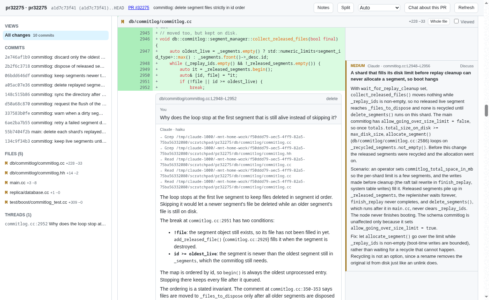
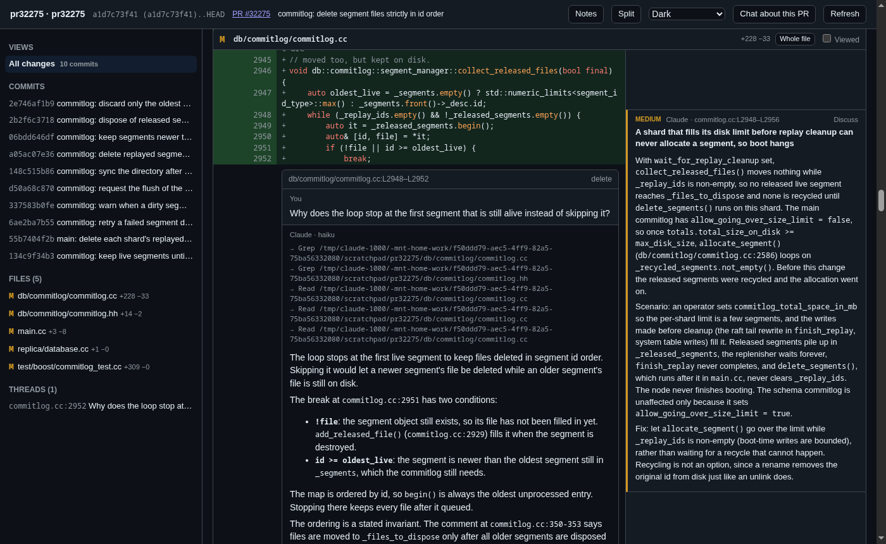
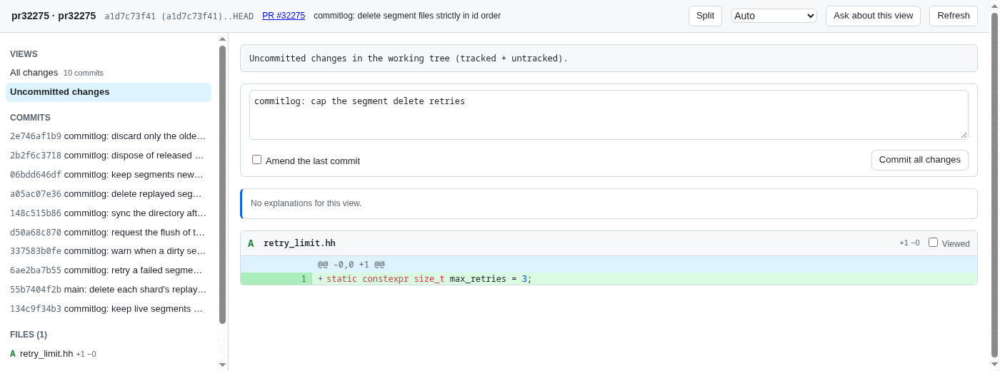

# prv: review pull requests locally, with Claude

`prv` serves a GitHub-like review page for a git checkout: the commits, the files and the diff of
a branch against its base. Select lines and ask Claude about them; Claude reads the whole checkout
to answer.


- **Ask about lines.** Click a line number (shift-click for a range), type a question. The answer
  streams in, and the thread is saved in `<git-dir>/prv/threads.json`.
- **Chat about the PR.** In "All changes", **Chat about this PR** starts a thread about the whole PR;
  Claude also gets the PR title, description and Jira keys. In a commit view the same button asks
  about that commit.
- **Explanations.** A summary of the PR, and notes next to each hunk or, per commit, next to the
  lines they explain. Run from the page, or with `prv explain` (`prv explain --commits` for line notes).
- **AI review.** A Claude review (Fable by default) that reports defects with a failure scenario.
  Each finding shows next to its lines; **Discuss** opens a thread about it.
- **Qodo review.** Runs `qodo review` and shows its findings the same way, when the
  [qodo CLI](https://www.qodo.ai/) is installed.
- **GitHub.** Links to the PR and its Jira issues, and the PR's review comments under their lines,
  read with `gh`. prv writes to GitHub only through Push (below). Jira links point to `scylladb.atlassian.net`;
  `prv --jira-url https://<site>.atlassian.net/browse/` points them to another site.
- **Changes since an earlier version.** After a rebase, an amend or a force-push, **Changes since…**
  shows what the author changed since a tip you pick, without the changes that came with the new base,
  and how each commit changed (below).
- **Commit and push.** The "Uncommitted changes" view commits everything it shows, or amends the
  last commit. With `--allow-push`, **Push** sends HEAD to your own open PR's branch (below).
- **New review.** `prv new_review <PR>` checks a PR out (or brings an existing checkout up to date),
  with its submodules, and opens it.
- Split or unified diff, whole-file view, Viewed marks, light and dark themes.

## Screenshots

A finding from the AI review next to the lines it is about, and a GitHub review comment under its line:


A question about selected lines, with Claude's answer in the thread (light and dark theme):




Line notes beside one commit's diff (`prv explain --commits`):


The commit card in "Uncommitted changes":



## Requirements

- Linux (macOS should work but is untested), Python 3.9 or newer (standard library only), git. git 2.41 or newer lets prv
  guess the base branch; with an older git, name it: `prv master`.
- [Claude Code](https://docs.claude.com/en/docs/claude-code) (`claude` on PATH, logged in) for
  questions, explanations and the AI review.
- Optional: [GitHub CLI](https://cli.github.com/) (`gh`, logged in) for PR links, review comments
  and `prv new_review`; the qodo CLI for the Qodo review.

## Install

The repository is private: ask the owner to add you as a collaborator, then clone it with your
GitHub login (`gh repo clone bitpathfinder/review_tool` works too).

```sh
git clone https://github.com/bitpathfinder/review_tool.git
cd review_tool
./install.sh
```

`install.sh` copies prv to `~/.local/share/prv` and links `~/.local/bin/prv` to it. It checks the
requirements and warns about missing optional tools. Options:

- `--dev`: link to the checkout instead of copying, so a `git pull` updates prv.
- `--reference PATH`: a local clone of the repository you review. `prv new_review` clones from it
  with hardlinks, which takes seconds instead of a full GitHub clone.
- `--repo OWNER/NAME`: the GitHub repository for `prv new_review` (default `scylladb/scylladb`).
- `--uninstall`: remove prv. The config file stays.

`--reference` and `--repo` are saved in `~/.config/prv/config.json`:

```json
{"reference": "/home/me/work/scylladb", "repo": "scylladb/scylladb"}
```

## Use

```sh
cd my-checkout
prv                    # the branch against its closest fork point on master/main/branch-*
prv upstream/master    # or name the base
prv --fetch            # fetch upstream (or origin) first
```

prv prints a URL with a token: open it in a browser. It listens on all interfaces by default, so
you can open it from another machine by IP; the token is the only guard. Use `--host 127.0.0.1` to
keep it local. The port is fixed per repository, so browser settings stick.

To review someone's PR from a folder that holds your checkouts:

```sh
cd ~/work
prv new_review 12345   # checks out PR_12345/<repo> on branch pr12345 and serves it
```

Run it again to bring the checkout up to date: a fast-forward is applied, and a force-pushed PR
keeps the old tip on a branch `pr12345-old-<sha>`. Local changes stop the update instead of being
lost. Explanations and line notes are written in the background unless you pass `--no-explain`.
The checkout skips Git LFS downloads (ScyllaDB's LFS files are PGO profiles that review does not need).

## Changes since an earlier version

**Changes since…** in the side panel lists earlier tips of the branch:

- the PR head GitHub reported, when this checkout has it and HEAD is not behind it;
- `<branch>-old-*` branches, where `prv new_review` keeps the tip of a rewritten PR;
- reflog entries of the branch that an amend, a rebase, a reset or a fast-forward replaced.

A sha typed into the box works too. The view has two parts:

- The commits of the old tip against the current ones, from `git range-diff`: unchanged, changed,
  new and dropped. A changed commit opens to show how its patch changed.
- One diff of what the author changed. The old tip's changes are replayed onto the current base
  (`git merge-tree`, git 2.40 or newer) and compared with HEAD, so a rebase onto a newer master adds
  nothing. A file whose replay conflicts is left out; its commits above still compare.

GitHub review threads show beside the lines they were written on, including lines the author has
since changed, unless the new base moved that line more than 20 lines.

## Commit and push

In "Uncommitted changes", **Commit all changes** runs `git add -A` and `git commit`. **Amend the last
commit** folds the changes into the newest commit of the range; an empty message keeps the old one.
Commit is refused while a Claude thread with "Allow edits" runs.

`prv --allow-push` shows **Push** for an open PR whose author is your `gh` login. It reads the PR from
GitHub again, then shows the target branch, the commits to push and, after an amend or rebase, the
commits the push removes. The push is `git push --force-with-lease`, leased on the commit GitHub
reported, so it fails if anyone pushed to the branch since. It pushes to a remote whose only push URL is
the PR's head repository on github.com, or to its GitHub URL in the scheme your upstream or origin remote uses.

While `--allow-push` is set, anyone with the URL can push to your PR, since prv listens on all
interfaces by default. Combine it with `--host 127.0.0.1` when you do not need remote access.

## How Claude runs

prv starts `claude -p` in the checkout with read-only tools: Read, Grep, Glob and git read commands
through `prv.py git`, a wrapper that refuses options that write files or run programs. It uses
`--setting-sources user`, so a reviewed branch's `.claude/settings.json` cannot change Claude's
permissions. "Allow edits" in the question box lets Claude edit files (never commit).

There is no cost cap by default. Pass `--max-budget-usd` to `prv explain` or `prv new_review` to set one.

## Files

Everything prv writes for a checkout lives in `<git-dir>/prv/`: threads, explanations, review
findings and the cached GitHub data.

## Tests

```sh
python3 -m unittest test_prv.py
```

## Third-party code

`vendor/` holds [highlight.js](https://highlightjs.org/) (BSD-3-Clause),
[marked](https://marked.js.org/) (MIT) and [DOMPurify](https://github.com/cure53/DOMPurify)
(Apache-2.0 or MPL-2.0), each with its license header.

## License

MIT, see [LICENSE](LICENSE).
