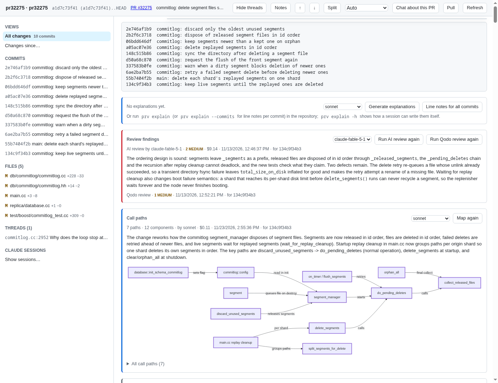
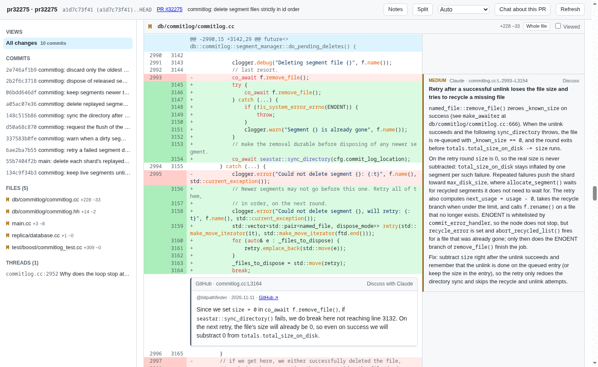
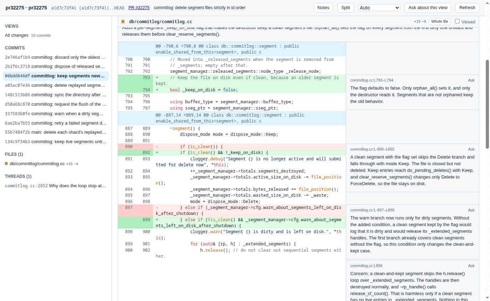
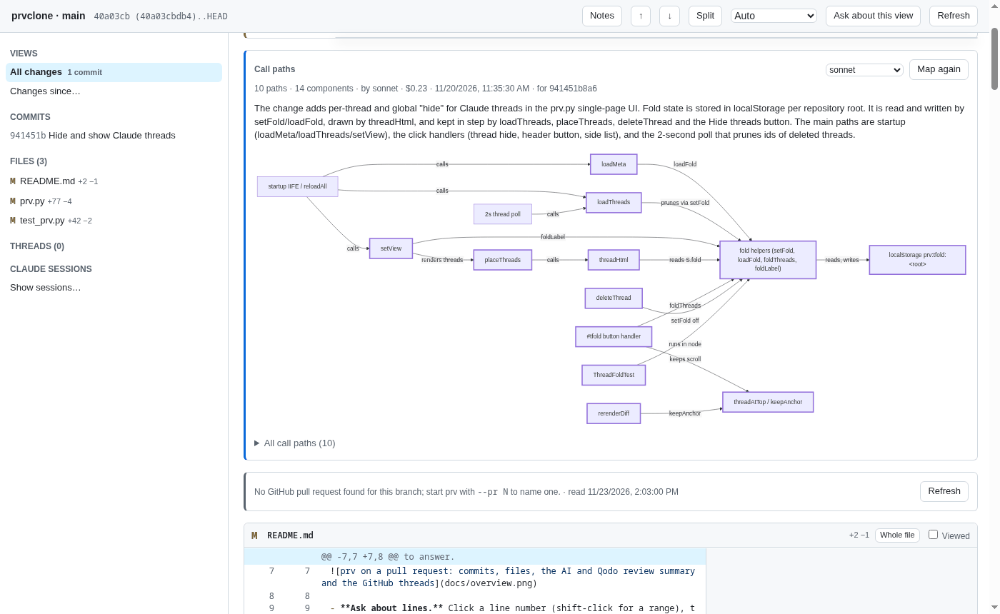
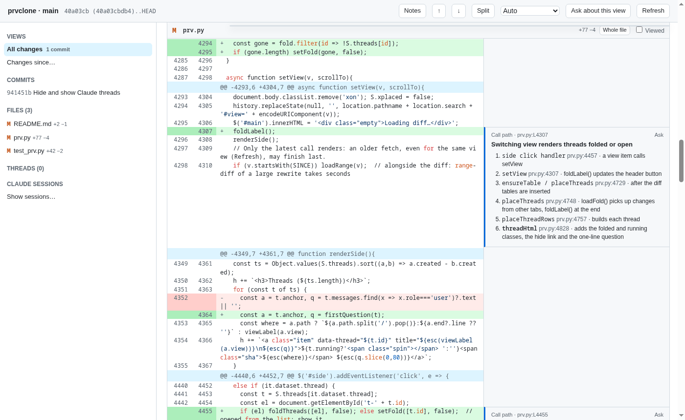

# prv: review pull requests locally, with Claude

`prv` serves a GitHub-like review page for a git checkout: the commits, the files and the diff of
a branch against its base. Select lines and ask Claude about them; Claude reads the whole checkout
to answer.



- **Ask about lines.** Click a line number (shift-click for a range), type a question. The answer
  streams in, and the thread is saved in `<git-dir>/prv/threads.json`. **hide** on a thread shrinks
  it to a one-line header; **Hide threads** in the header shrinks every thread in the view.
  In a commit's view, **Whole PR** in the question box asks about the whole PR instead of the commit:
  Claude reads the PR's last commit and every commit in the range. The box starts checked and keeps
  its last setting.
- **Batch questions.** **Add to batch** in the question box saves the question instead of asking it. When
  you are done, **Process N questions** in the header asks them one at a time, in the order you added them;
  press it again to stop. An "Allow edits" question waits while another thread edits the working tree.
  The queue survives a restart.
- **Chat about the PR.** In "All changes", **Chat about this PR** starts a thread about the whole PR;
  Claude also gets the PR title, description and Jira keys. In a commit view the same button asks
  about that commit, or with **Whole PR** checked about the whole PR, with the same PR details.
- **Explanations.** A summary of the PR, and notes next to each hunk or, per commit, next to the
  lines they explain. Run from the page, or with `prv explain` (`prv explain --commits` for line notes).
- **AI review.** A Claude review (Fable by default) that reports defects with a failure scenario.
  Each finding shows next to its lines; **Discuss** opens a thread about it.
- **Call paths.** Claude walks the callers of the changed code and lists call stacks from an entry point
  (a request handler, a timer, main, a test) down to each change, plus a diagram of the components the
  change touches. Each stack shows next to its changed lines. Click a frame or a diagram box to open its
  line: in the diff, or in a read-only source popup for a file the view does not change. **Map call
  paths** in "All changes" maps the whole range, in a commit view that commit; `prv callpaths`
  (`--commits` for each commit) does the same from the shell. Sonnet by default.
- **Qodo review.** Runs `qodo review` and shows its findings the same way, when the
  [qodo CLI](https://www.qodo.ai/) is installed.
- **GitHub.** Links to the PR and its Jira issues, and the PR's review comments under their lines,
  read with `gh`, in "All changes" and in each commit. Your own comments and replies go to GitHub as
  one review (below). Jira links point to `scylladb.atlassian.net`;
  `prv --jira-url https://<site>.atlassian.net/browse/` points them to another site.
- **Changes since an earlier version.** After a rebase, an amend or a force-push, **Changes since…**
  shows what the author changed since a tip you pick, without the changes that came with the new base,
  and how each commit changed (below).
- **Claude sessions.** The side panel lists the Claude Code sessions behind the review, with the
  command that resumes each one (below).
- **Commit and push.** The "Uncommitted changes" view commits everything it shows, or amends the
  last commit. With `--allow-push`, **Push** sends HEAD to your own open PR's branch (below).
- **New review.** `prv new_review <PR>` checks a PR out (or brings an existing checkout up to date),
  with its submodules, and opens it. **Pull** in the header brings it up to date later.
- **One prv per checkout.** When another prv already serves the checkout, prv asks whether to stop it
  and serve here; `--replace` stops it without asking. `prv new_review` asks before it touches an
  existing checkout, so the update never moves files under a running prv. When the update of an
  existing checkout on branch `pr<N>` fails, for example on uncommitted changes, it serves the
  checkout as it is.
- **Go to a definition.** Ctrl-click (Cmd-click on a Mac) a name in the code to jump to where the
  files of the view define or declare it, opening "Whole file" when needed. Several matches show a
  list, those in the clicked file first. **← Back** in the header (key `b`) returns to where you clicked.
  Found with [Universal Ctags](https://ctags.io/) (`ctags`). Ctrl-click works in the source popup too,
  but finds only definitions in the files of the view.
- Split or unified diff, whole-file view, Viewed marks, light and dark themes. **↑** and **↓** in the
  header (keys `p` and `n`) jump to the previous or next change shown, across files and inside a whole file.
  Drag the edge of the side panel or of the notes column to change that panel's width; a double-click
  on the edge restores the default.

## Screenshots

A finding from the AI review next to the lines it is about, and a GitHub review comment under its line:



A question about selected lines, with Claude's answer in the thread:


Line notes beside one commit's diff (`prv explain --commits`):



Call paths (**Map call paths**): the components a change touches, and a call stack beside the changed
lines it ends at. Each frame opens its line:




The commit card in "Uncommitted changes":


## Requirements

- Linux (macOS should work but is untested), Python 3.9 or newer (standard library only), git.
  "Changes since…" needs git 2.40 or newer. Tested on Fedora 43, Debian 12 (git 2.39) and Ubuntu 22.04 (git 2.34).
- [Claude Code](https://docs.claude.com/en/docs/claude-code) (`claude` on PATH, logged in) for
  questions, explanations and the AI review.
- [Universal Ctags](https://ctags.io/) with JSON output (`ctags`) for go to definition.
- Optional: [GitHub CLI](https://cli.github.com/) (`gh`, logged in) for PR links, review comments
  and `prv new_review`; the qodo CLI for the Qodo review.
- git-lfs is not needed: without it, `prv new_review` checks LFS files out as their pointer files.

## Install on a new machine

1. Install the dependencies: git, Python 3.9 or newer, Universal Ctags, the GitHub CLI and Claude Code.

   ```sh
   # Debian, Ubuntu
   sudo apt-get update && sudo apt-get install -y git python3 universal-ctags gh curl
   # Fedora
   sudo dnf install -y git python3 ctags gh curl
   # Arch
   sudo pacman -S --needed git python ctags github-cli curl
   # openSUSE
   sudo zypper install git python3 ctags gh curl
   # macOS
   brew install git python universal-ctags gh

   # Claude Code, into your home folder (no sudo)
   curl -fsSL https://claude.ai/install.sh | bash
   ```

   Only git is needed for the next step: `./install.sh` installs whatever is still missing.
2. Clone prv and install it:

   ```sh
   git clone https://github.com/bitpathfinder/review_tool.git
   cd review_tool
   ./install.sh
   ```
3. If install.sh says `~/.local/bin` is not on PATH, add it to your shell profile and open a new shell:
   `echo 'export PATH="$HOME/.local/bin:$PATH"' >> ~/.bashrc`.
4. Log in once: `gh auth login` for GitHub, then `claude` for Claude Code.
5. Review a PR. Any folder works; prv creates `PR_<N>/<repository name>` in it:

   ```sh
   mkdir -p ~/work && cd ~/work
   prv new_review 12345          # --repo OWNER/NAME for another repository
   ```

   prv prints a URL: open it. The first clone of scylladb from GitHub, with its submodules, took
   50 s in a test on a fast connection. A local scylladb clone and git-lfs are not needed.

## Install options

`install.sh` first installs the missing tools: git, python3, Universal Ctags and gh with the system
package manager (apt-get, dnf, zypper, pacman or brew, with sudo when not root), and Claude Code with its
installer (`curl -fsSL https://claude.ai/install.sh | bash`, into your home folder). It installs what it
can and warns about the rest; only a missing git or python3 3.9 or newer stops it. The qodo CLI needs a
Qodo account and is left to you. Then it copies prv to `~/.local/share/prv` and links `~/.local/bin/prv` to it.
Options:

- `--no-deps`: install nothing but prv; only check the tools and warn about missing ones.
- `--dev`: link to the checkout instead of copying, so a `git pull` updates prv.
- `--reference PATH`: optional, a local clone of the repository you review. `prv new_review` clones
  from it with hardlinks, which takes seconds instead of a full GitHub clone. Without one,
  `prv new_review` clones from GitHub.
- `--repo OWNER/NAME`: the GitHub repository for `prv new_review` (default `scylladb/scylladb`).
- `--uninstall`: remove prv. The config file stays.

`--reference` and `--repo` are saved in `~/.config/prv/config.json`:

```json
{"reference": "/home/me/work/scylladb", "repo": "scylladb/scylladb"}
```

## Use

```sh
cd my-checkout
prv                    # the branch against its closest fork point on master/main/branch-*
prv upstream/master    # or name the base
prv --fetch            # fetch upstream (or origin) first
```

prv prints a URL with a token: open it in a browser. It listens on all interfaces by default, so
you can open it from another machine by IP; the token is the only guard. Use `--host 127.0.0.1` to
keep it local. The port is fixed per repository, so browser settings stick.

To review someone's PR from a folder that holds your checkouts:

```sh
cd ~/work
prv new_review 12345   # checks out PR_12345/<repo> on branch pr12345 and serves it
```

Run it again to bring the checkout up to date: a fast-forward is applied, and a force-pushed PR
keeps the old tip on a branch `pr12345-old-<sha>`. Local changes stop the update instead of being
lost. A PR already merged into its base branch is reviewed against the base commit GitHub reports
for it, so its own commits show. Explanations and line notes are written in the background unless
you pass `--no-explain`. So are the call paths of the whole range (not per commit, which would cost one run per commit).
The checkout skips Git LFS downloads (ScyllaDB's LFS files are PGO profiles that review does not need).

**Pull** in the header does the same update while prv runs, then serves the range from the new fork
point, so a PR rebased onto a newer base shows only its own commits. After a force-push, **Changes
since** the old head shows what the author changed. Pull shows in a checkout on branch `pr<N>` whose
`upstream` remote is on GitHub. It is refused while a Claude thread, an explanation or a review runs, since
they read the working tree.

## Changes since an earlier version

**Changes since…** in the side panel lists earlier tips of the branch:

- the PR head GitHub reported, when this checkout has it and HEAD is not behind it;
- `<branch>-old-*` branches, where `prv new_review` keeps the tip of a rewritten PR;
- reflog entries of the branch that an amend, a rebase, a reset or a fast-forward replaced.

A sha typed into the box works too. The view has two parts:

- The commits of the old tip against the current ones, from `git range-diff`: unchanged, changed,
  new and dropped. A changed commit opens to show how its patch changed.
- One diff of what the author changed. The old tip's changes are replayed onto the current base
  (`git merge-tree`, git 2.40 or newer) and compared with HEAD, so a rebase onto a newer master adds
  nothing. A file whose replay conflicts is left out; its commits above still compare.

GitHub review threads show beside the lines they were written on, including lines the author has
since changed, unless the new base moved that line more than 20 lines. **Hide GitHub** in the header hides
them; your pending comments stay.

## GitHub review

In "All changes" of a PR, select lines, switch the question box to **GitHub comment** and press **Save to
review**, or press **Reply** under a GitHub thread. The question box keeps the last mode per browser. prv
saves the text as a pending comment in `<git-dir>/prv/github-drafts.json` and shows it under its line,
with edit and delete. **Review** in the header lists the pending comments and posts them, with an
optional summary, as one GitHub review:
Comment, Approve or Request changes. Replies go to their threads in the same step. prv asks before it
posts. A comment or reply that GitHub refuses stays pending. A comment goes on lines of one hunk of the
PR's diff, as GitHub requires, so lines that only "Whole file" shows take none.

Review is refused when HEAD is not the PR head GitHub reports, or when a pending line comment was written
on an older head, since GitHub places a comment by its line number in the PR head. Pull, or delete the
stale comment and write it again.

## Claude sessions

**Show sessions…** at the bottom of the side panel lists two groups:

- prv's runs: threads, explanations, line notes and AI reviews. prv keeps their session ids in
  `threads.json` and `sessions.json`.
- Other sessions in this checkout: every session Claude Code keeps for this folder in
  `~/.claude/projects/` (`$CLAUDE_CONFIG_DIR/projects/` when set), such as the session that wrote the
  change. A session started in another folder is not listed, even when it worked in this checkout.

Click a session for its `cd <folder> && claude --resume <id>` command, which also sets
`CLAUDE_CONFIG_DIR` (and `CLAUDE_CODE_PROJECT_DIR_NAME`) when prv runs with them. A resumed session
runs with your usual Claude Code settings and permissions, not with the read-only tools prv gives its
runs.

## Commit and push

In "Uncommitted changes", **Commit all changes** runs `git add -A` and `git commit`. **Amend the last
commit** folds the changes into the newest commit of the range; an empty message keeps the old one.
Commit is refused while a Claude thread with "Allow edits" runs.

`prv --allow-push` shows **Push** for an open PR whose author is your `gh` login. It reads the PR from
GitHub again, then shows the target branch, the commits to push and, after an amend or rebase, the
commits the push removes. The push is `git push --force-with-lease`, leased on the commit GitHub
reported, so it fails if anyone pushed to the branch since. It pushes to a remote whose only push URL is
the PR's head repository on github.com, or to its GitHub URL in the scheme your upstream or origin remote uses.

While `--allow-push` is set, anyone with the URL can push to your PR, since prv listens on all
interfaces by default. Combine it with `--host 127.0.0.1` when you do not need remote access.

## How Claude runs

prv starts `claude -p` in the checkout with read-only tools: Read, Grep, Glob and git read commands
through `prv.py git`, a wrapper that refuses options that write files or run programs. It uses
`--setting-sources user`, so a reviewed branch's `.claude/settings.json` cannot change Claude's
permissions. "Allow edits" in the question box lets Claude edit files (never commit).

A question about a commit, "All changes" or "Changes since" runs Claude in a worktree of that commit
(the view's head), under `<git-dir>/prv/wt/`. Grep and Read then see the files as the commit has them,
so a file renamed by a later commit keeps its old name. A **Whole PR** question about a commit reads
the head's worktree instead. The worktree has no submodules. A turn with
"Allow edits" runs in the checkout itself. prv removes a worktree once no thread uses it. The
explanations, the AI review and the call paths work the same way: a run reads a worktree of the head, or
of the commit for a commit's notes, removed when the run ends. A run on the commit the checkout is at,
with no tracked changes, reads the checkout itself and so sees its submodules.

There is no cost cap by default. Pass `--max-budget-usd` to `prv explain`, `prv callpaths` or `prv new_review`
to set one. `prv new_review` applies the cap to the explanations and to the call paths separately, so the two
together can cost twice the cap. `prv callpaths --commits` applies it to each commit's run.

## Files

Everything prv writes for a checkout lives in `<git-dir>/prv/`: threads, explanations, review
findings, call paths, the ids of its Claude sessions, the cached GitHub data and your pending GitHub
comments. `lock` holds the pid of the prv serving the checkout.

## Tests

```sh
python3 -m unittest test_prv.py
```

## Third-party code

`vendor/` holds [highlight.js](https://highlightjs.org/) (BSD-3-Clause),
[marked](https://marked.js.org/) (MIT), [DOMPurify](https://github.com/cure53/DOMPurify)
(Apache-2.0 or MPL-2.0) and [Mermaid](https://mermaid.js.org/) 11.4.1 (MIT), each with its license header.
The page loads Mermaid only when it draws a diagram.

## License

MIT, see [LICENSE](LICENSE).
